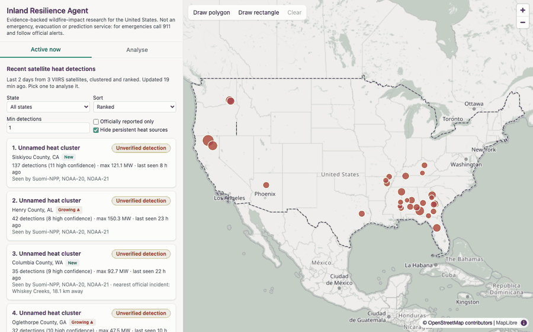
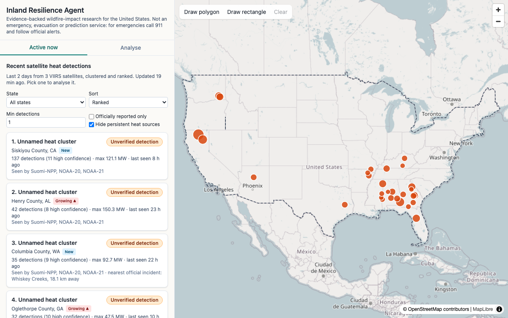
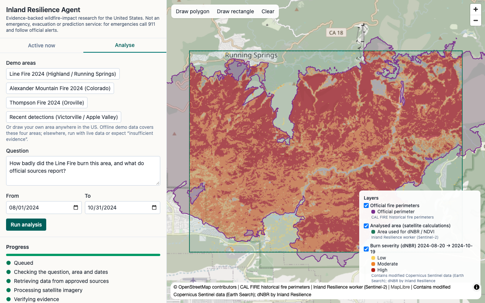
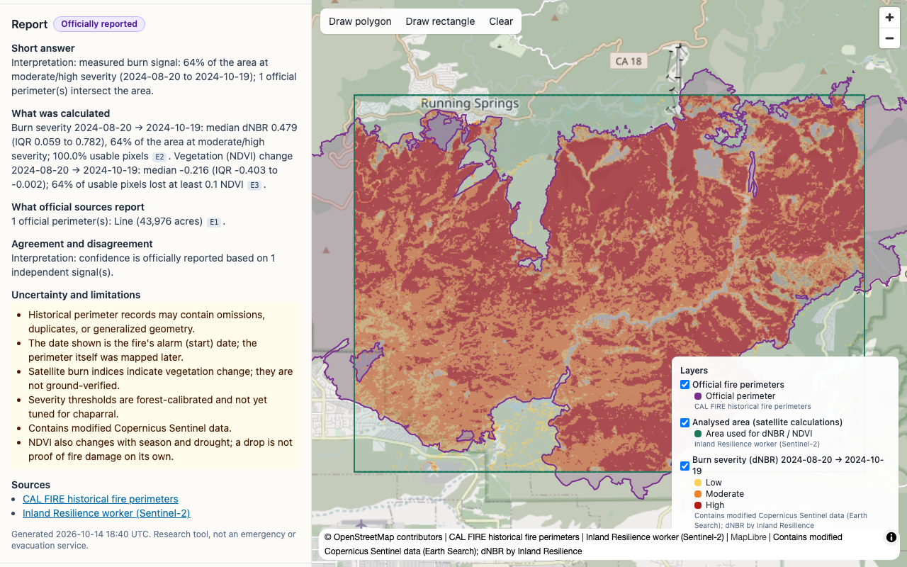
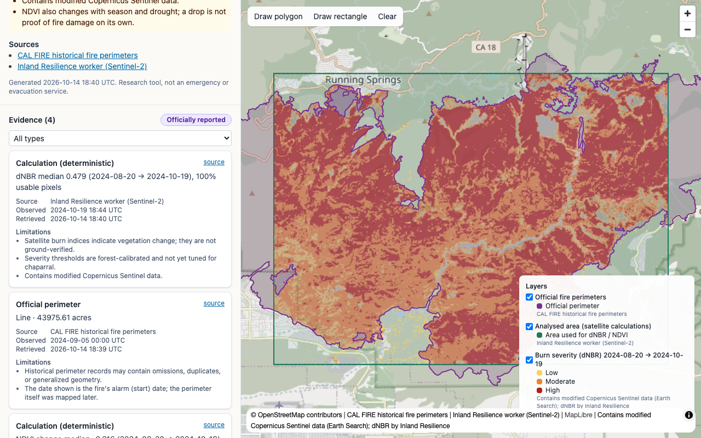

<div align="center">

# Wildfire Evidence Agent

**Draw an area, ask a question about a wildfire, and get an answer where every fact is cited, timestamped and honest about its limits.**

[](https://github.com/samin1554/wildfire-evidence-agent/actions/workflows/ci.yml)


[](LICENSE)



</div>

> **A research tool, not an emergency service.** It does not give evacuation guidance, warnings or fire predictions. In an emergency, call 911 and follow official alerts.

I designed and built this end to end: the architecture, a Go API, a Python worker with a LangGraph agent and satellite maths, a React/MapLibre front end, the data connectors, and the Docker/CI setup. In the UI the app is called **Inland Resilience Agent**: it started as a San Bernardino County project and now covers the United States.

**Contents:** [What it does](#what-it-does) · [Architecture](#architecture) · [How a request flows](#how-a-request-flows) · [Run it](#run-it) · [Design decisions](#design-decisions) · [Testing](#testing) · [Limitations](#limitations)

## What it does

- **Active now.** A national feed of recent NASA FIRMS heat detections from three VIIRS satellites, clustered, ranked, named by county and matched to official perimeters. A cluster is labelled an *unverified detection*, never a "confirmed fire".
- **Analyse an area.** Pick a demo fire or draw any polygon in the US, ask a question, choose dates. The agent plans which approved tools to run, the worker fetches and computes, and progress streams live to the browser.
- **Measure the burn.** Sentinel-2 L2A imagery (no account needed) gives dNBR burn severity and NDVI change on the user's own area, with clouds and water masked out, drawn as map overlays.
- **Cite everything.** Every fact is an evidence card with its source, observed time, retrieved time and limitations. The report has a confidence label (`officially_reported`, `unverified_detection`, …) and an explicit *insufficient evidence* answer when data is missing.

| Active now | Burn severity over the official perimeter |
|---|---|
|  |  |
| **Cited report** | **Evidence cards** |
|  |  |

The burn maths was checked against the official map before it was built in: for the 2024 Line Fire, Sentinel-2 dNBR matched the USFS BAER soil burn severity map class-for-class on 54.9% of pixels and within one class on 98.5% ([write-up](docs/research/line-fire-2024/README.md)).


## Architecture


| App | Stack | Job |
|---|---|---|
| `apps/web` | React, TypeScript, Vite, MapLibre, Terra Draw | Presentation only: never calls providers or holds secrets |
| `apps/api` | Go, chi, pgx, SSE | Public API, strict validation (PostGIS checks the area), job creation, progress stream |
| `apps/worker` | Python 3.12, LangGraph, rasterio | Data connectors, geospatial maths, the agent, map overlays |

PostgreSQL + PostGIS · Redis Streams · Docker Compose. Map overlay tiles are written to a shared volume.

Three rules hold the design together:

1. **The model plans and explains; code calculates.** Areas, dNBR, NDVI, overlaps and confidence labels come from deterministic functions. The LLM picks from a fixed set of tools and words the answer, and its output is validated. Without an LLM key the agent falls back to a rule-based planner.
2. **Only the worker's connector kit talks to providers.** Every source (FIRMS, NIFC WFIGS, CAL FIRE, NWS, Sentinel-2, Census TIGERweb) is configured in one `providers.yaml` and goes through one allowlisted HTTP client with caching, stale snapshots and tracing.
3. **Contracts first.** `contracts/openapi.yaml` and JSON schemas define the API, jobs, events and evidence, so the three apps can't drift apart.

More diagrams (request lifecycle, agent workflow, job state machine, schemas, ingestion): [docs/README.md](docs/README.md#diagrams).

## How a request flows

| Step | Where |
|---|---|
| 1. Client checks: inside the US, under 5,000 km², valid polygon | web |
| 2. `POST /v1/analyses`: strict JSON, dates ≤ 3 years, PostGIS validity / region / area | Go API |
| 3. Insert the job as `queued` and `XADD jobs` (the API's only status write) | Go API → Redis |
| 4. A worker claims it with `XREADGROUP`; guarded status transitions, DB first, then an event | worker |
| 5. Agent: scope check → plan → approved tools → verify → cited report | worker |
| 6. dNBR/NDVI on the user's grid; overlay tiles rendered | worker |
| 7. SSE: missed history, DB snapshot, then live events until a terminal status | Go API |
| 8. Evidence, layers and report → map, cards and report panel | web |

**Reliability:** heartbeats keep a job's lease, a reaper reclaims messages from dead workers, three attempts then a dead-letter stream, a 10-minute wall clock, and cancellation checked between every step. Details: [docs/demo/README.md](docs/demo/README.md).

## Run it

Needs only [Docker Desktop](https://docs.docker.com/get-docker/). No keys or accounts: by default everything runs offline on recorded data.

```bash
git clone https://github.com/samin1554/wildfire-evidence-agent.git
cd wildfire-evidence-agent
make dev            # postgres/postgis, redis, migrations, seed, api, worker, web
```

Open **http://localhost:5173** and pick a demo area:

| Demo area | What runs | Expected confidence |
|---|---|---|
| **Line Fire 2024** (Highland / Running Springs, CA) | CAL FIRE perimeter + Sentinel-2 dNBR and NDVI | `officially_reported` |
| **Alexander Mountain Fire 2024** (Colorado) | NIFC WFIGS perimeter + dNBR and NDVI | `officially_reported` |
| **Thompson Fire 2024** (Oroville, CA) | CAL FIRE perimeter + dNBR and NDVI | `officially_reported` |
| **Recent detections** (Victorville / Apple Valley, CA) | FIRMS detections, current perimeters, NWS forecast | `unverified_detection` |

An area or date range the recordings don't cover honestly reports *insufficient evidence*, with the gaps listed.

**Live data (optional):** copy `.env.example` to `.env` and set `INLAND_DATA_MODE=live`. NIFC, CAL FIRE, NWS and Sentinel-2 need no key; NASA FIRMS needs a free [map key](https://firms.modaps.eosdis.nasa.gov/api/map_key/) (`FIRMS_MAP_KEY`), and an optional free [OpenRouter](https://openrouter.ai/keys) key (`OPENROUTER_API_KEY`) lets an LLM plan and word the answer.

Other commands:

```bash
make demo-line-fire   # the Line Fire dNBR-vs-BAER research figure (Docker, no keys)
make down             # stop (V=1 also deletes data)
```

## Design decisions

Each significant choice is written up as an ADR in [`docs/adr/`](docs/adr/README.md). Highlights:

- [ADR-002](docs/adr/ADR-002-progress-events-and-sse.md) / [ADR-004](docs/adr/ADR-004-job-status-single-writer.md): progress over Redis Streams and SSE, with a single writer for job status.
- [ADR-003](docs/adr/ADR-003-job-retries-and-cancellation.md): retries, dead-letter and cancellation.
- [ADR-006](docs/adr/ADR-006-cache-and-snapshots.md): provider cache and last-known-good snapshots, so a failed refresh serves stale data with a flag, never silently.
- [ADR-007](docs/adr/ADR-007-llm-provider.md) / [ADR-010](docs/adr/ADR-010-agent-before-job-runtime.md): a controlled LangGraph agent on free models, with a deterministic fallback.
- [ADR-009](docs/adr/ADR-009-imagery-without-earth-engine.md): Sentinel-2 through Earth Search instead of Google Earth Engine.
- [ADR-012](docs/adr/ADR-012-national-region.md) / [ADR-013](docs/adr/ADR-013-activity-feed.md): national scope and the "Active now" feed.

## Testing

All tests run offline on recorded provider responses (`INLAND_DATA_MODE=fixture`), and every connector is checked against success, empty, malformed and extra-field recordings.

```bash
make test       # worker (pytest), API (go test, in Docker), web (vitest)
make e2e        # end-to-end acceptance against a running stack, incl. crash/retry/cancel
make e2e-ui     # Playwright browser test of the full Line Fire flow
make lint
```

CI runs the same checks on every push ([`.github/workflows/ci.yml`](.github/workflows/ci.yml)).

## Limitations

- Satellite burn indices measure vegetation change, not ground-verified damage; severity thresholds are the standard forest values and aren't yet tuned for chaparral.
- A FIRMS heat detection can be a fire, a flare or another hot surface. That's why it's never reported as a confirmed fire.
- Official perimeters can be late, generalized or missing; missing data is reported as missing, never as "nothing happened".
- No authentication yet ([ADR-008](docs/adr/ADR-008-authentication.md) is open), so this is meant to run locally.

## Docs

[Documentation index](docs/README.md) · [Running the full stack](docs/demo/README.md) · [Data catalog](docs/data-catalog.md) · [Connector guide](docs/connectors/connector-guide.md) · [Contributing](CONTRIBUTING.md)

## License

[MIT](LICENSE) © 2026 Sayed Amin. Imagery contains modified Copernicus Sentinel data.
