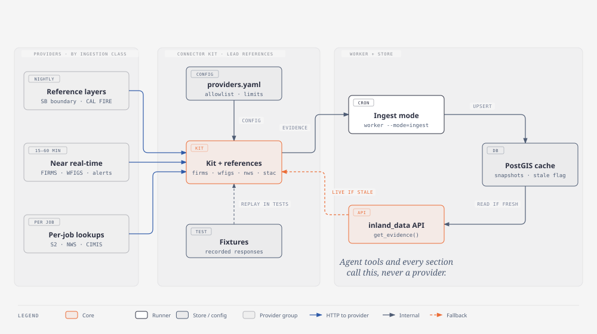

# Inland Resilience Agent: documentation

Find what you need by what you're trying to do.

## Start here
- **[Running the full stack](demo/README.md)**: `make dev`, the demo areas, how a request flows, fixture vs live.
- [Contributing](../CONTRIBUTING.md)

## I need data
- **[Data catalog](data-catalog.md)**: every source, its `provider_id`, freshness, and how to get it in one line.
- **[Connector guide](connectors/connector-guide.md)**: how to add a source (copy a reference connector) and how to read data.
- [Provider spec template](connectors/provider-spec-template.md) · [Provider specs](connectors/providers/)

## I need the contracts
The shared formats live in [`contracts/`](../contracts/): the API spec (`openapi.yaml`), the evidence, job and job-event schemas, and real examples in `contracts/examples/`. The API validates requests against them and the worker writes evidence that matches them.

## I want to know why something is the way it is
- **[Architecture decisions (ADRs)](adr/README.md)**
- **Deviations from the spec:** satellite imagery uses Earth Search + official BAER/MTBS maps instead of Google Earth Engine ([ADR-009](adr/ADR-009-imagery-without-earth-engine.md)); CAL FIRE historical perimeters use `California_Historic_Fire_Perimeters` because the spec's URL only holds 2025 fires.
- **Research:** [Line Fire 2024 burn-severity proof](research/line-fire-2024/README.md)

Source spec: `Inland_Resilience_Agent_Project_Spec.md` (Sep 23, 2026).

## Diagrams

The `.svg` files render here on GitHub. Open the matching `.html` file in a browser for exact fonts and extra notes.

### Architecture: three apps, one boundary each

### Request lifecycle: the API answers first, the worker does the work

### Agent workflow: fixed tools, evidence before answers

### Database schema

### Cache and snapshot tables (ADR-006)

### Job state machine

### Ingestion pipeline: one kit in, one API out

